# Arquitectura SaaS — Plataforma de Auditoría de Nómina (Argentina)

> **Alcance.** Este documento define la arquitectura técnica integral de una plataforma SaaS de **auditoría continua de nómina** para estudios contables y empresas: ingesta multi-fuente (LSD, F931, ERPs), mesa de reconciliación de conceptos, motor de reglas (LCT, CCTs, Seguridad Social, sindicatos, Ganancias 4ta categoría), auditoría comparativa con hallazgos, y un marco de seguridad alineado con la Ley 25.326.
>
> **Relación con este repositorio.** El MVP actual (auditoría de *liquidaciones finales*: `apps/api`, `apps/web`, `packages/motor-calculo`) se conserva y pasa a ser un **módulo de dominio ("Egresos")** dentro de la plataforma. La sección 13 detalla el camino de migración.
>
> **Aviso.** Alícuotas, topes, escalas y plazos citados son ejemplos para ilustrar el diseño. En la plataforma **ningún valor normativo vive en código**: todos se cargan como parámetros versionados por vigencia y deben validarse con asesoría laboral/impositiva antes de producción.

---

## Índice

1. [Principios rectores y decisiones clave](#1-principios-rectores-y-decisiones-clave)
2. [Vista de contexto y de contenedores](#2-vista-de-contexto-y-de-contenedores)
3. [Stack tecnológico](#3-stack-tecnológico)
4. [Pipeline de ingesta multi-fuente](#4-pipeline-de-ingesta-multi-fuente)
5. [Mesa de Reconciliación (Mapping Desk) y Auto-Match](#5-mesa-de-reconciliación-mapping-desk-y-auto-match)
6. [Motor de reglas y cálculo teórico](#6-motor-de-reglas-y-cálculo-teórico)
7. [Auditoría comparativa y hallazgos](#7-auditoría-comparativa-y-hallazgos)
8. [Modelo de datos (PostgreSQL)](#8-modelo-de-datos-postgresql)
9. [Experiencia de usuario (UX/UI) y exportación a Excel](#9-experiencia-de-usuario-uxui-y-exportación-a-excel)
10. [Seguridad, multi-tenancy y Ley 25.326](#10-seguridad-multi-tenancy-y-ley-25326)
11. [Infraestructura, despliegue y operación](#11-infraestructura-despliegue-y-operación)
12. [Atributos de calidad: rendimiento, escalabilidad y observabilidad](#12-atributos-de-calidad)
13. [Migración desde el MVP y roadmap](#13-migración-desde-el-mvp-y-roadmap)
14. [Registro de decisiones (ADRs) y riesgos](#14-registro-de-decisiones-adrs-y-riesgos)

---

## 1. Principios rectores y decisiones clave

| # | Principio | Consecuencia técnica |
|---|---|---|
| P1 | **Lo declarado por el cliente es inmutable.** | Las liquidaciones ingresadas se guardan tal cual (con hash del archivo de origen). El motor nunca las corrige: produce un cálculo teórico paralelo y un hallazgo por diferencia. |
| P2 | **Normativa = datos versionados, lógica = código testeado.** | Escalas CCT, alícuotas, topes, tablas de Ganancias y SMVM son filas con `vigencia_desde/hasta`. Las fórmulas son funciones puras TypeScript con tests. Toda auditoría es **reproducible**: se registra versión del motor + hash del snapshot de parámetros. |
| P3 | **Cada número es explicable.** | Cada cálculo teórico guarda su traza (`fórmula`, `base`, `parámetros usados`, `fuente normativa`). El auditor puede responder "¿de dónde sale este $?" sin leer código. |
| P4 | **Devengado ≠ percibido.** | Cada concepto guarda `periodo_devengamiento` y `fecha_pago`. Seguridad Social se audita por devengado (con período de ajuste del LSD); Ganancias 4ta se audita por percibido. |
| P5 | **Aislamiento por diseño, no por disciplina.** | Row-Level Security en PostgreSQL + claves de cifrado por tenant + prefijos de storage por tenant. Un bug en la capa de aplicación no alcanza para leer datos de otro tenant. |
| P6 | **Asíncrono por defecto para lo pesado.** | Ingesta, auditoría y exportaciones grandes corren en workers con colas; la UI muestra progreso en tiempo real (SSE). |
| P7 | **Excel es un ciudadano de primera.** | Toda vista analítica exporta a `.xlsx` con fórmulas nativas, formato contable y metadatos de trazabilidad. |
| P8 | **Monolito modular antes que microservicios.** | Un backend NestJS con módulos de dominio bien delimitados + workers separados por tipo de carga. Se extrae un servicio solo cuando su perfil de escala lo exige (el motor de reglas es el primer candidato). |

---

## 2. Vista de contexto y de contenedores

### 2.1 Contexto (actores y sistemas externos)

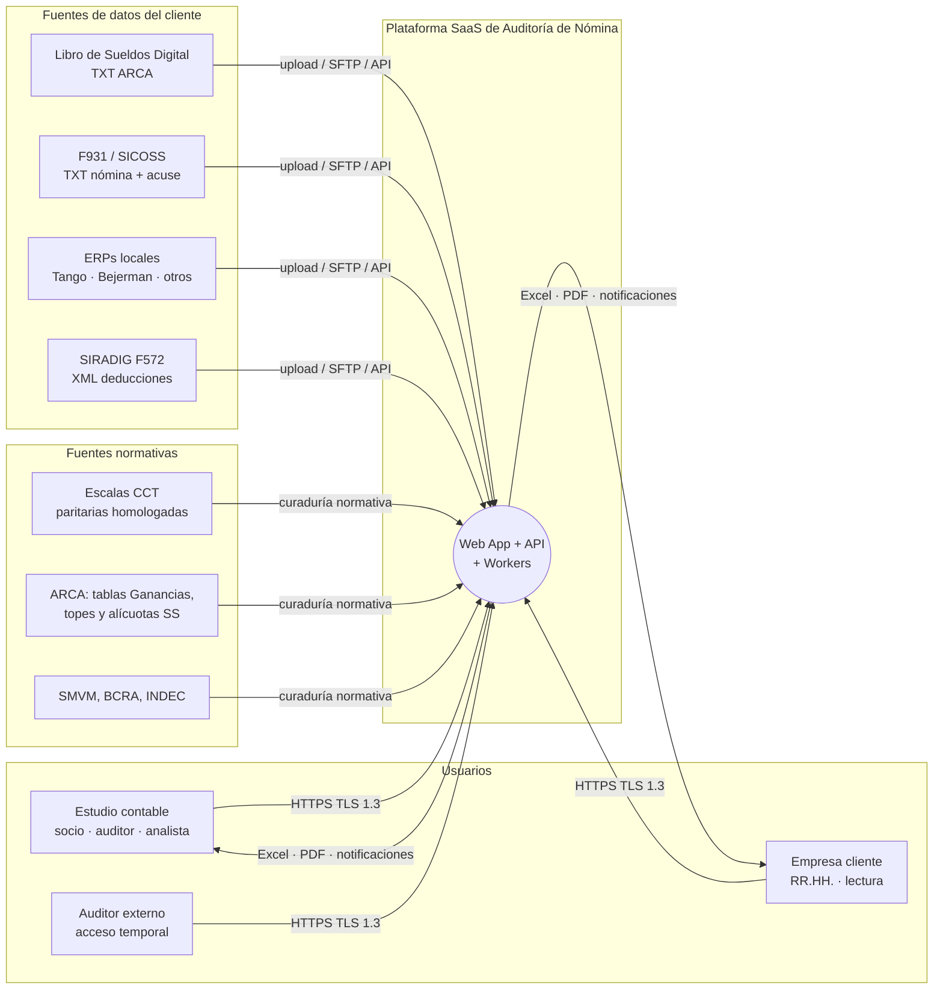

### 2.2 Contenedores

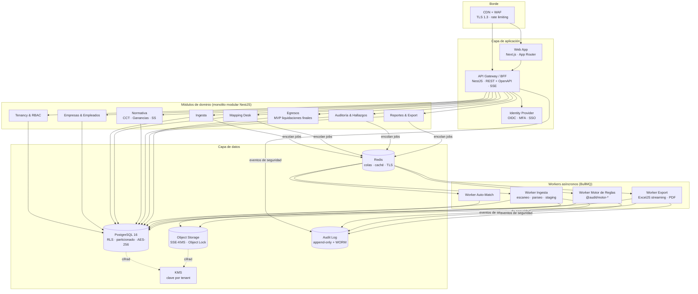

**Bounded contexts.** Cada módulo es dueño de sus tablas; la comunicación entre módulos es por servicios de aplicación (llamadas in-process) y por **eventos de dominio** (`IngestaConfirmada`, `MapeoActualizado`, `AuditoriaFinalizada`) publicados en una tabla *outbox* y consumidos por los workers. Esto mantiene la opción de extraer módulos a servicios sin reescribir contratos.

---

## 3. Stack tecnológico

Se mantiene el stack del MVP (TypeScript end-to-end) y se completa para operar como SaaS:

| Capa | Tecnología | Justificación |
|---|---|---|
| Frontend | **Next.js 15 + React + TypeScript + Tailwind + shadcn/ui** | Ya en uso. SSR para tableros, RSC para vistas pesadas. |
| Grillas | **AG Grid Community** (alternativa: TanStack Table + TanStack Virtual) | Virtualización de filas/columnas, columnas fijas (*pinned*), ordenamiento multi-columna, edición en celda y navegación por teclado listas para usar. |
| Backend | **NestJS 10 + Prisma** (Kysely/SQL crudo para consultas analíticas y `COPY`) | Ya en uso. Prisma para CRUD transaccional; SQL explícito donde importa el rendimiento (inserts masivos, agregaciones). |
| Motor de reglas | **`@audit/motor-*`**: paquetes TypeScript puros (sin I/O) | Extiende `packages/motor-calculo`. Testeable en aislamiento, ejecutable en worker o en el navegador (simulaciones). |
| Base de datos | **PostgreSQL 16** (RLS, particionado declarativo, `pg_trgm`, `pgcrypto`) | Transaccional, auditable, con primitivas de aislamiento nativas. |
| Colas | **BullMQ + Redis 7** (TLS, AUTH) | Ya previsto en el MVP. Prioridades, reintentos con *backoff*, *rate limiting* por tenant. |
| Storage | **S3** (prod) / **MinIO** (dev) con SSE-KMS y Object Lock | Archivos de origen, exportaciones, anclaje WORM del audit log. |
| Identidad | **Keycloak** (self-hosted) o **Auth0/Cognito** — OIDC + MFA (TOTP/WebAuthn) | SSO con Google Workspace / Microsoft Entra de los estudios. |
| Excel | **ExcelJS** (streaming writer) | Fórmulas nativas, formato condicional, paneles congelados, sin límite práctico de filas en streaming. |
| Parsing | Parsers propios de ancho fijo (LSD/F931), **ExcelJS / SheetJS** (ERPs), **fast-xml-parser** (SIRADIG), **ClamAV** (antimalware) | Formatos estructurados: no se requiere OCR en el camino principal. |
| Observabilidad | **OpenTelemetry** → Grafana (Tempo, Loki, Prometheus) o Datadog | Trazas distribuidas API → cola → worker con `tenant_id` y `job_id`. |
| Infraestructura | **AWS** (ECS Fargate, RDS, ElastiCache, S3, KMS, WAF) + **Terraform** | Ver §11 sobre residencia de datos. |

---

## 4. Pipeline de ingesta multi-fuente

### 4.1 Fuentes soportadas

| Fuente | Formato | Qué aporta | Estrategia de parseo |
|---|---|---|---|
| **Libro de Sueldos Digital (LSD)** | TXT de ancho fijo, registros tipificados (01: cabecera del envío/CUIT/período; 02: datos de la liquidación por CUIL; 03: detalle de conceptos; 04: datos para la DJ F931; registros adicionales según el formato vigente) | Conceptos por empleado **con el código de concepto ARCA asociado**, cantidades, importes, indicador débito/crédito y período de ajuste; bases imponibles por CUIL. | Parser declarativo: una **especificación de layout versionada** (`posicion`, `longitud`, `tipo`, `decimales`) por versión del formato ARCA. Validación de totales de control. |
| **F931 / SICOSS** | TXT de nómina exportado de "Declaración en línea"/SICOSS + acuse (PDF/datos) | Remuneraciones 1 a N por CUIL, situación de revista, condición, actividad, modalidad de contratación, obra social, aportes y contribuciones declarados. | Parser de ancho fijo versionado. El acuse se usa solo para conciliar totales. |
| **Tango / Bejerman / otros ERPs** | Excel/CSV de "libro de sueldos", "acumulados por concepto", recibos | Conceptos con **código y descripción locales** (sin código ARCA en muchos casos), legajo, categoría, convenio. | **Plantillas de importación por ERP** (mapeo de columnas guardado por empresa) + detección automática de encabezados. |
| **SIRADIG F572 web** (opcional) | XML | Deducciones generales y cargas de familia declaradas por cada empleado. | Necesario para auditar Ganancias con precisión. |
| **Escalas CCT** (curaduría interna) | Planilla estándar / carga en backoffice | Básicos por categoría, adicionales, sumas no remunerativas, vigencias. | Flujo de doble control (carga + aprobación) — ver §6.4. |

### 4.2 Flujo de procesamiento

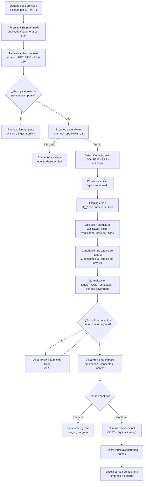

### 4.3 Decisiones de diseño de la ingesta

- **Staging separado del modelo productivo.** Las tablas `stg_lsd_registro`, `stg_f931_nomina`, `stg_erp_fila` guardan cada línea con `archivo_id` y `nro_linea`. Los errores se reportan con referencia exacta al archivo y línea de origen ("Línea 4.512: CUIL con dígito verificador inválido").
- **Idempotencia.** Clave natural de ingesta: `(empresa_id, tipo_fuente, sha256)`. Reintentos de jobs no duplican datos. Una re-ingesta del mismo período con contenido distinto crea una **nueva versión** de la liquidación (`version`, `reemplaza_a`), nunca un `UPDATE` destructivo.
- **Layouts versionados.** Cuando ARCA cambia el formato del LSD o del F931, se agrega una especificación nueva (`lsd_layout_v2`) sin tocar parsers anteriores: un período histórico se re-parsea con el layout que regía entonces.
- **Conciliación LSD ↔ F931.** Si para un período existen ambos, se ejecuta la regla `SS-010` (§7.2): las bases por CUIL derivadas del LSD deben coincidir con las Remuneraciones declaradas en el F931.
- **Carga masiva eficiente.** Los workers escriben con `COPY ... FROM STDIN` en lotes de 10.000 filas dentro de una transacción; una empresa de 5.000 legajos × 60 conceptos (~300.000 filas/mes) se confirma en segundos.
- **Progreso en vivo.** Cada job publica avance (`parseadas`, `con_error`, `pendientes_mapeo`) por **Server-Sent Events**.

### 4.4 Secuencia de una ingesta típica

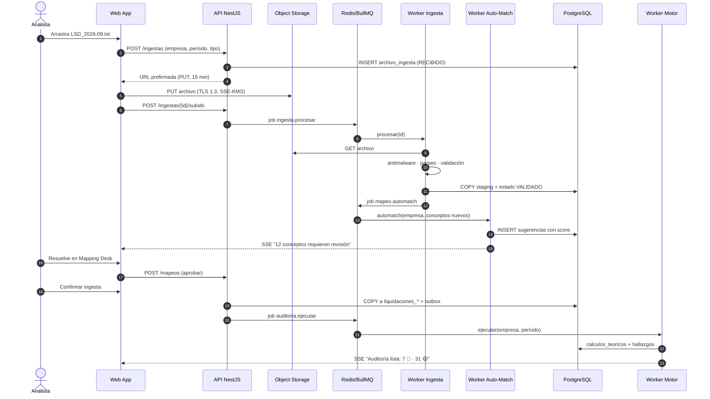

---

## 5. Mesa de Reconciliación (Mapping Desk) y Auto-Match

### 5.1 Problema

Cada empresa liquida con **sus propios códigos** ("0110 - Sueldo Básico", "B01 - Básico Mens.", "Hs. Ext. 50%"). El motor necesita saber qué *es* cada concepto (**concepto canónico**) y cómo **impacta fiscalmente**: si es remunerativo, si integra la base de aportes/contribuciones, si está gravado en Ganancias, si integra el SAC, la base de vacaciones o la base indemnizatoria.

### 5.2 Modelo conceptual

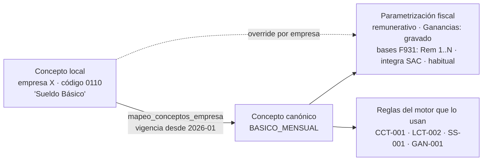

- El **catálogo canónico** es global y curado (≈150–250 conceptos: básico, antigüedad, presentismo, horas extra 50/100, SAC, vacaciones, feriados, licencias, sumas no remunerativas de acuerdos, aportes, cuota sindical, retención Ganancias, embargos, etc.). Cada canónico trae una **parametrización fiscal por defecto**.
- El **mapeo por empresa** (`mapeo_conceptos_empresa`) vincula el código local con el canónico, **con vigencia**, y puede **sobrescribir** la parametrización (p.ej. una empresa liquida un "bono" que en su caso no es habitual).
- Cambiar un mapeo **no reescribe** auditorías pasadas: crea una vigencia nueva y ofrece "re-auditar períodos afectados".

### 5.3 Motor de Auto-Match

Para cada concepto local sin mapeo vigente se calcula un **score de confianza** combinando señales independientes:

| Señal | Peso inicial | Descripción |
|---|---|---|
| `s_arca` — Código de concepto ARCA (LSD) | 0,35 | Si el concepto viene del LSD con código ARCA asociado, es la señal más fuerte (aunque no unívoca: varios canónicos comparten código ARCA). |
| `s_texto` — Similitud de descripción | 0,25 | Normalización (minúsculas, sin acentos, expansión de abreviaturas: "hs"→"horas", "antig"→"antigüedad", "sac"→"aguinaldo") + similitud trigram (`pg_trgm`) y TF-IDF contra descripciones y sinónimos del canónico. |
| `s_historia` — Mapeos previos | 0,20 | Mapeos aprobados del mismo código/descripción en otras empresas **del mismo tenant** y en el mismo ERP. A nivel global solo se usan estadísticas agregadas y anonimizadas (frecuencia descripción→canónico), nunca datos de otro tenant. |
| `s_numerico` — Comportamiento del monto | 0,15 | Ratios contra el básico del mismo recibo: ≈ 8,33 % sugiere presentismo (p.ej. Comercio); ≈ 1 % × años de antigüedad sugiere antigüedad; aparece solo en junio/diciembre sugiere SAC; signo débito con ≈ 11 % sugiere aporte jubilatorio. |
| `s_bases` — Afectación declarada | 0,05 | Coherencia entre las marcas de bases del LSD/F931 y la parametrización por defecto del canónico candidato. |

```
score(c, k) = Σ w_i · s_i(c, k)                      # c: concepto local, k: canónico candidato
score_calibrado = calibrar(score)                     # regresión isotónica sobre decisiones históricas

decisión:
  score_calibrado ≥ 0,92 y margen con el 2.º candidato ≥ 0,15  → AUTO-APROBADO (registrado y reversible)
  0,60 ≤ score_calibrado < 0,92                                 → SUGERIDO (requiere un clic)
  score_calibrado < 0,60                                        → MANUAL (búsqueda asistida)
```

- **Aprendizaje.** Cada aprobación, corrección o rechazo queda en `mapeo_feedback` y reentrena los pesos y la calibración por lote (job nocturno). Los umbrales son configurables por tenant (un estudio conservador puede desactivar la auto-aprobación).
- **Explicabilidad.** La UI muestra *por qué* se sugiere ("código ARCA 120000 ✓ · descripción 82 % similar · aparece en jun/dic ✓").
- **Evolución.** Si el volumen lo justifica, `s_texto` puede reemplazarse por *embeddings* (pgvector) sin cambiar el contrato del servicio.

### 5.4 Ciclo de vida de un mapeo

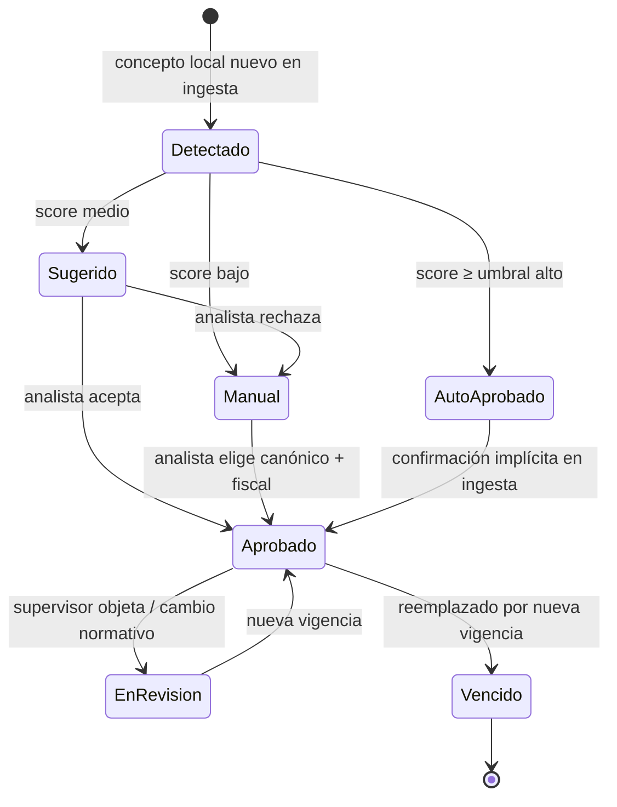

### 5.5 Interfaz del Mapping Desk

- **Grilla de pendientes** agrupada por empresa → concepto local, con columnas: código local, descripción, ocurrencias, monto total del período, top-3 candidatos con score (barras), estado.
- **Panel lateral de parametrización fiscal**: tipo (remunerativo / no remunerativo / descuento), Ganancias (gravado / exento / no alcanzado / deducción), bases F931 (casillas por Remuneración 1..N), integra SAC / vacaciones / base indemnizatoria art. 245, habitualidad, vigencia desde.
- **Acciones masivas**: aprobar todas las sugerencias ≥ X, aplicar el mismo mapeo a todas las empresas del tenant con el mismo ERP.
- **Doble control opcional**: los cambios de parametrización fiscal requieren aprobación de un rol `supervisor` (configurable por tenant).

---

## 6. Motor de reglas y cálculo teórico

### 6.1 Arquitectura del motor

El motor es un conjunto de paquetes **puros** (sin acceso a base de datos ni red), orquestados por el Worker Motor, que les inyecta los datos ya resueltos:

```
packages/
  motor-core/            → tipos, Decimal, contexto, registro de reglas, trazas
  motor-calculo/         → (existente) liquidaciones finales: art. 245, preaviso, SAC prop., vacaciones
  motor-cct/             → básicos y adicionales convencionales (escalas como datos)
  motor-lct/             → SAC, vacaciones, horas extra, feriados, SMVM, licencias
  motor-seguridad-social → aportes, contribuciones, topes de base imponible, ART, seguro de vida
  motor-sindical/        → cuota sindical, aportes solidarios, contribuciones convencionales
  motor-ganancias/       → retención 4ta categoría (acumulativa, criterio percibido)
```

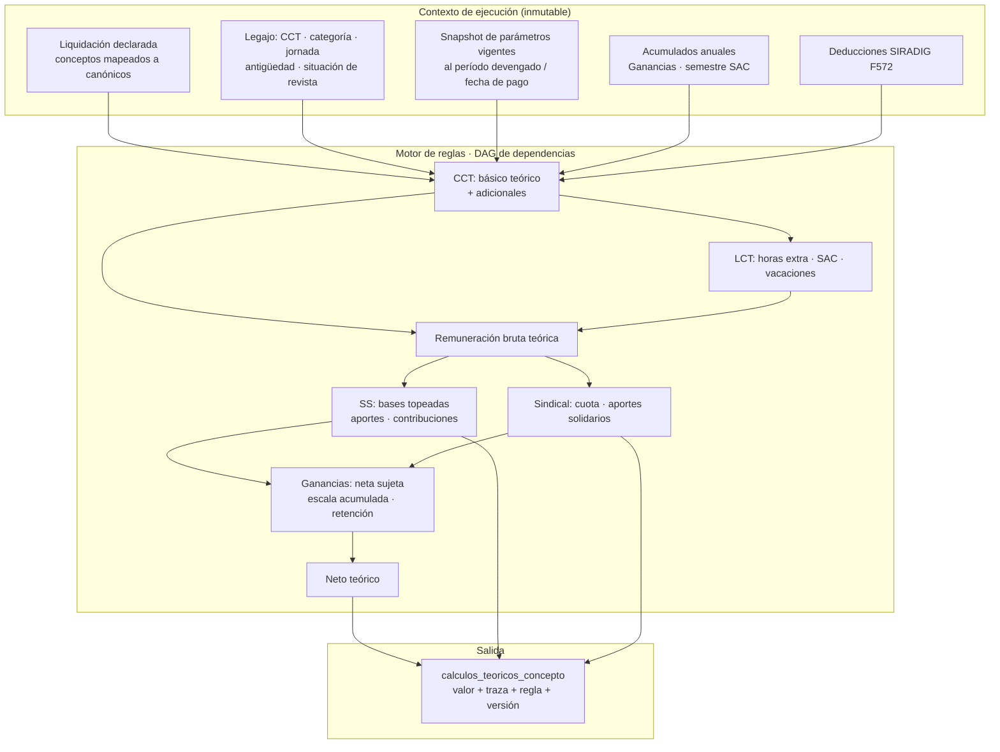

### 6.2 Contrato de una regla

```ts
export interface Regla<I, O> {
  id: string;                         // 'SS-001'
  version: string;                    // semver de la lógica: '2.1.0'
  ambito: 'CCT' | 'LCT' | 'SS' | 'SINDICAL' | 'GANANCIAS' | 'INTEGRIDAD';
  conceptosCanonicos: string[];       // qué conceptos produce/valida
  dependeDe: string[];                // ids de reglas previas (DAG)
  aplica(ctx: ContextoLegajo): boolean;               // p.ej. solo si CCT 130/75
  calcular(ctx: ContextoLegajo, previos: ResultadosPrevios): ResultadoRegla<O>;
}

export interface ResultadoRegla<O> {
  valores: O;                         // montos teóricos por concepto canónico (Decimal)
  traza: PasoTraza[];                 // [{ descripcion, formula, valores, fuenteNormativa }]
  advertencias: string[];             // datos faltantes, supuestos aplicados
}
```

- **Aritmética exacta.** Todos los montos usan `Decimal` (decimal.js) y redondeo explícito por regla (p.ej. *half-up* a 2 decimales al final, no en pasos intermedios). Nunca `number` de punto flotante para dinero.
- **DAG.** El registro ordena topológicamente las reglas por `dependeDe`; reglas independientes de un mismo legajo se evalúan en paralelo lógico, y los legajos se distribuyen en *chunks* entre workers.
- **Reproducibilidad.** Cada corrida guarda `motor_version` (versión del paquete), `parametros_hash` (SHA-256 del snapshot de parámetros) y `mapeos_hash`. Re-ejecutar con los mismos tres valores produce el mismo resultado bit a bit (tests de *golden files*).

### 6.3 Pseudocódigo de reglas representativas

**CCT — básico y adicionales (data-driven):**

```ts
// Escala: cct_escalas(cct, categoria, vigencia_desde, basico, jornada_referencia)
basicoTeorico = escala(cct, categoria, periodo).basico
              × proporcionJornada(legajo.jornada, escala.jornada_referencia)
              × proporcionDiasTrabajados(periodo, altas/bajas/licencias sin goce)

// Adicionales declarados como datos (DSL acotada, ver §6.5):
//   { codigo: 'ANTIGUEDAD', base: ['BASICO'], tipo: 'porcentaje_por_anio', valor: 0.01 }
//   { codigo: 'PRESENTISMO', base: ['BASICO','ANTIGUEDAD'], tipo: 'porcentaje', valor: 0.0833,
//     condicion: 'sin_ausencias_injustificadas' }
//   { codigo: 'SUMA_NR_ACUERDO_2026_09', tipo: 'monto_fijo', valor: 40000, remunerativo: false }
```

**LCT — SAC (arts. 121–122) y vacaciones (arts. 150 y 155):**

```ts
sac = mejorRemuneracionMensualDevengadaEnSemestre(conceptosQueIntegranSAC) / 2
      × diasTrabajadosSemestre / diasSemestre
vacacionesDia = remuneracionMensual / 25        // mensualizados, art. 155 LCT
vacaciones    = vacacionesDia × diasCorrespondientes(antiguedad, CCT)
```

**Seguridad Social — aportes y contribuciones:**

```ts
baseAportes     = clamp(Σ conceptos que integran Rem. aportes,
                        topes.baseMinima(periodo), topes.baseMaxima(periodo))
aporteSIPA      = baseAportes × alic.jubilacion       // p.ej. 11 %
aporteINSSJP    = baseAportes × alic.ley19032         // p.ej. 3 %
aporteOS        = baseAportesOS × alic.obraSocial     // p.ej. 3 %
contribuciones  = (baseContrib − detraccion(empresa, periodo)) × alic.contribuciones(empresa)
                  // alícuota según condición de la empresa (actividad/tamaño) y período
contribucionART = baseART × alicuotaContratoART(empresa) + cuotaFija
```

**Ganancias 4ta categoría — retención acumulativa (criterio percibido):**

```ts
// Todo acumulado de enero al mes de pago del año fiscal en curso
gananciaBruta    = Σ conceptos gravados percibidos (incluye SAC y otros según parámetros vigentes)
deducAportes     = Σ aportes SIPA + INSSJP + OS + cuota sindical retenidos
deducGenerales   = aplicarTopes(SIRADIG_F572, gananciaNetaAntesDeDeduccionesTopeadas)
                   // alquiler, servicio doméstico, prepaga, honorarios médicos, seguros, etc.
deducPersonales  = (GNI + deduccionEspecial + cargasFamilia) acumuladas al mes
                   // tablas de ARCA con vigencia (actualizaciones periódicas)
gnsi             = max(0, gananciaBruta − deducAportes − deducGenerales − deducPersonales)
impuestoAcum     = escalaArt94Acumulada(mes).aplicar(gnsi)
retencionTeorica = impuestoAcum − Σ retenciones practicadas en meses anteriores
retencionTeorica = aplicarLimitesRetencionMensual(retencionTeorica, parametros)
// Si es negativa: devolución teórica al empleado (hallazgo si no se reintegró).
```

### 6.4 Gestión normativa (parámetros versionados)

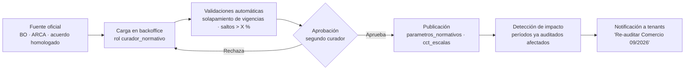

- Los parámetros normativos son **globales** (no por tenant) y solo los edita el equipo de curaduría de la plataforma, con doble firma y referencia a la fuente (`norma`, `url`, `fecha_publicacion`).
- Los acuerdos paritarios **retroactivos** se modelan como una vigencia nueva con `vigencia_desde` en el pasado; el sistema detecta los períodos afectados y propone re-auditar (hallazgos de tipo "retroactivo no liquidado").
- Cada tenant puede definir **parámetros propios** (p.ej. beneficios por encima del convenio, alícuota ART del contrato) que se superponen a los globales, nunca los reemplazan.

### 6.5 ¿Reglas en código o en una DSL?

**Decisión: híbrido.** La *lógica* legal (SAC, Ganancias acumulativa, topes) vive en TypeScript tipado y testeado: es compleja, cambia poco y su error es caro. Los *valores* (escalas, alícuotas, tablas) y los **adicionales de convenio simples** (porcentaje sobre bases, montos fijos, condiciones de presentismo) se expresan en una **DSL JSON acotada** y validada por JSON Schema, evaluada por un intérprete propio (sin `eval`). Así, cargar un CCT nuevo no requiere un *deploy*; cambiar cómo se calcula Ganancias sí, con revisión de código y tests.

---

## 7. Auditoría comparativa y hallazgos

### 7.1 Algoritmo de comparación

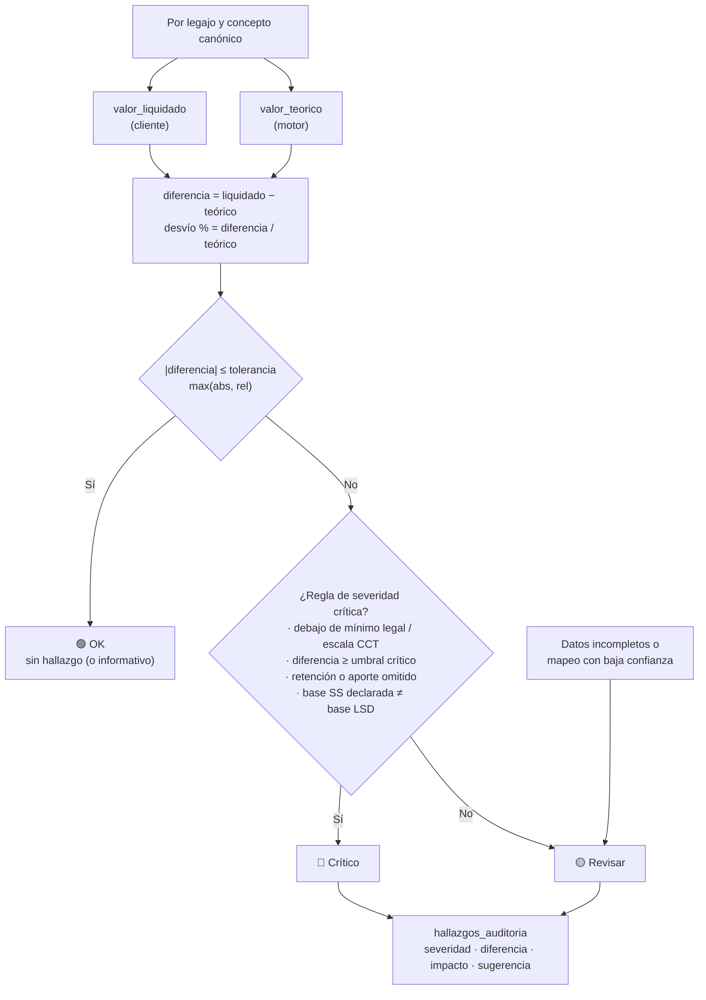

**Tolerancias y umbrales por defecto (configurables por tenant y por regla):**

| Nivel | Condición (ejemplo) |
|---|---|
| 🟢 OK | `|dif| ≤ max($ 1, 0,1 % del teórico)` |
| 🟡 Revisar | Fuera de tolerancia pero `|dif| < max($ 5.000, 2 %)`, o cálculo con advertencias (dato faltante, mapeo sugerido no confirmado) |
| 🔴 Crítico | `|dif| ≥ max($ 5.000, 2 %)`; o incumplimiento de mínimo (escala CCT, SMVM); o concepto obligatorio omitido; o inconsistencia LSD ↔ F931 |

### 7.2 Catálogo inicial de validaciones

| Código | Ámbito | Validación | Severidad base |
|---|---|---|---|
| INT-001 | Integridad | Neto = Σ haberes − Σ descuentos del recibo | 🔴 |
| INT-002 | Integridad | Legajo activo con liquidación faltante en el período | 🟡 |
| INT-003 | Integridad | CUIL inválido o duplicado entre legajos | 🔴 |
| CCT-001 | CCT | Básico liquidado < básico de escala vigente para la categoría y jornada | 🔴 |
| CCT-002 | CCT | Adicional por antigüedad mal calculado u omitido | 🟡/🔴 |
| CCT-003 | CCT | Presentismo/asistencia mal calculado | 🟡 |
| CCT-004 | CCT | Suma no remunerativa de acuerdo paritario omitida o con monto distinto | 🔴 |
| CCT-005 | CCT | Retroactivo de paritaria no liquidado | 🔴 |
| LCT-001 | LCT | SAC: base o proporción incorrecta | 🔴 |
| LCT-002 | LCT | Vacaciones: valor día distinto de remuneración/25 o días por antigüedad | 🟡 |
| LCT-003 | LCT | Horas extra: recargo 50 %/100 % incorrecto | 🟡 |
| LCT-004 | LCT | Remuneración inferior al SMVM proporcional | 🔴 |
| LCT-005 | LCT | Concepto con apariencia remunerativa liquidado como no remunerativo sin respaldo normativo | 🔴 |
| SS-001..003 | Seg. Social | Aportes SIPA / INSSJP / Obra Social sobre base topeada | 🔴 |
| SS-004 | Seg. Social | Base imponible fuera de topes mínimo/máximo del período | 🟡 |
| SS-005 | Seg. Social | Contribuciones patronales con alícuota o detracción incorrecta | 🔴 |
| SS-006 | Seg. Social | ART y seguro de vida obligatorio | 🟡 |
| SS-010 | Seg. Social | Bases LSD por CUIL ≠ Remuneraciones F931 | 🔴 |
| SS-011 | Seg. Social | Empleado en LSD ausente en F931 (o viceversa) | 🔴 |
| SIN-001 | Sindical | Cuota sindical a afiliado / no afiliado incorrecta | 🟡 |
| SIN-002 | Sindical | Aportes y contribuciones convencionales (p.ej. solidarios, FAECYS/INACAP en Comercio) omitidos | 🟡 |
| GAN-001 | Ganancias | Retención del mes ≠ retención teórica acumulada | 🔴 |
| GAN-002 | Ganancias | Concepto exento/no alcanzado tratado como gravado (o viceversa) | 🟡 |
| GAN-003 | Ganancias | Deducciones del F572 no aplicadas o aplicadas por encima del tope | 🟡 |
| GAN-004 | Ganancias | Devolución por retención acumulada negativa no efectuada | 🔴 |

### 7.3 Anatomía de un hallazgo

Cada hallazgo es autosuficiente para el informe y para el seguimiento:

- **Identificación:** empresa, legajo, CUIL (enmascarado en listados), período, concepto canónico, regla y versión.
- **Cuantificación:** `valor_liquidado`, `valor_teorico`, `diferencia`, `desvio_pct`, **impacto** clasificado (`a_favor_empleado` → contingencia laboral; `fiscal` → deuda con ARCA; `a_favor_empresa`) y estimación de **intereses resarcitorios** cuando aplica (parámetro de tasa vigente).
- **Explicación:** traza del cálculo teórico (pasos, fórmulas, parámetros y norma citada).
- **Sugerencia de acción** (plantilla por regla): "Liquidar diferencia de $ 45.320,10 como retroactivo en 10/2026 y rectificar F931 de 09/2026".
- **Workflow:** `abierto → en_analisis → justificado | corregido | aceptado_riesgo → cerrado`, con comentarios, responsable y adjuntos. Las justificaciones aceptadas se recuerdan para no re-alertar el mismo patrón ("supresión" con vencimiento).

---

## 8. Modelo de datos (PostgreSQL)

### 8.1 Diagrama entidad-relación

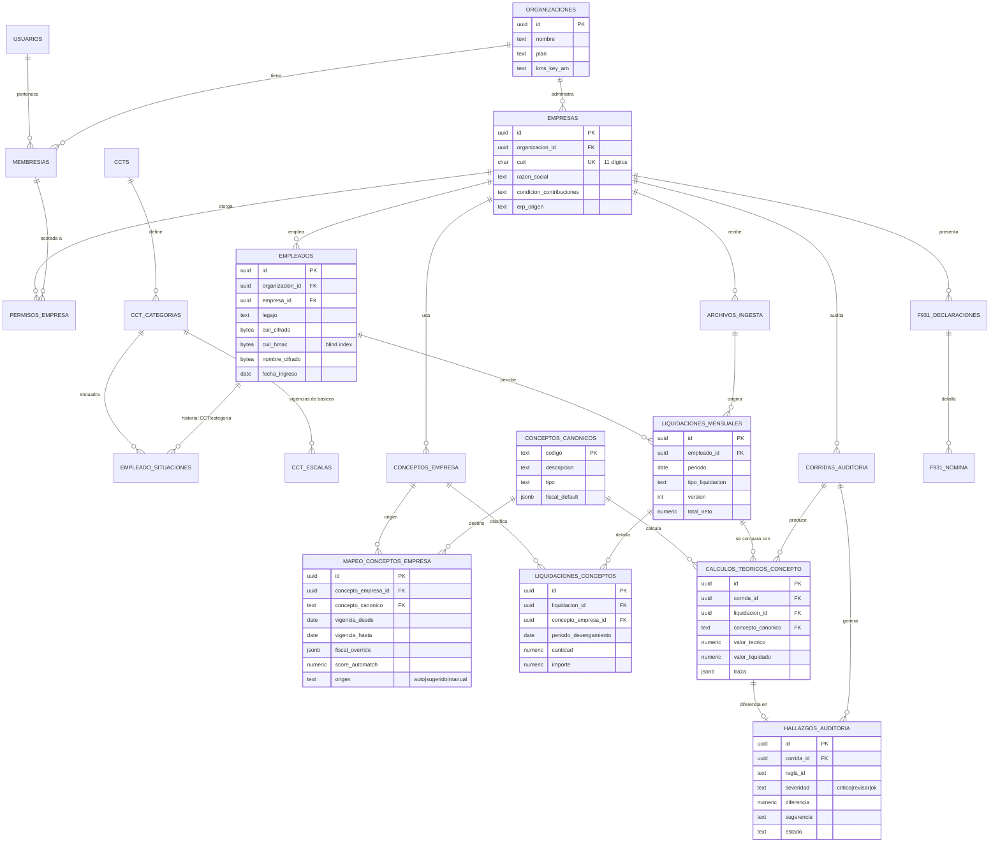

### 8.2 DDL de referencia

> Convenciones: montos en `NUMERIC(18,2)`, alícuotas en `NUMERIC(9,6)`, cantidades en `NUMERIC(12,4)`. Toda tabla de negocio lleva `organizacion_id` (tenant) para RLS — aun cuando sea derivable — porque las políticas RLS deben poder evaluarse sin *joins*. Las PK son UUIDv7 (ordenables por tiempo: mejor localidad de índice que UUIDv4).

```sql
-- =========================================================================
-- Extensiones
-- =========================================================================
CREATE EXTENSION IF NOT EXISTS pgcrypto;
CREATE EXTENSION IF NOT EXISTS pg_trgm;
CREATE EXTENSION IF NOT EXISTS citext;
CREATE EXTENSION IF NOT EXISTS btree_gist;   -- exclusión de vigencias solapadas

-- =========================================================================
-- Tenancy, identidad y RBAC
-- =========================================================================
CREATE TABLE organizaciones (
  id              UUID PRIMARY KEY,
  nombre          TEXT NOT NULL,
  cuit            CHAR(11),
  plan            TEXT NOT NULL DEFAULT 'estandar',
  kms_key_ref     TEXT NOT NULL,                 -- CMK/KEK del tenant (envelope encryption)
  retencion_anios SMALLINT NOT NULL DEFAULT 10,
  creado_en       TIMESTAMPTZ NOT NULL DEFAULT now()
);

CREATE TABLE usuarios (
  id          UUID PRIMARY KEY,
  idp_subject TEXT NOT NULL UNIQUE,              -- "sub" del IdP OIDC
  email       CITEXT NOT NULL UNIQUE,
  nombre      TEXT NOT NULL,
  mfa_activo  BOOLEAN NOT NULL DEFAULT false,
  activo      BOOLEAN NOT NULL DEFAULT true
);

CREATE TYPE rol_plataforma AS ENUM
  ('owner', 'supervisor', 'auditor', 'analista', 'cliente_lectura', 'auditor_externo');

CREATE TABLE membresias (
  id               UUID PRIMARY KEY,
  organizacion_id  UUID NOT NULL REFERENCES organizaciones(id),
  usuario_id       UUID NOT NULL REFERENCES usuarios(id),
  rol              rol_plataforma NOT NULL,
  todas_empresas   BOOLEAN NOT NULL DEFAULT false, -- false => solo las de permisos_empresa
  expira_en        TIMESTAMPTZ,                    -- obligatorio para auditor_externo
  UNIQUE (organizacion_id, usuario_id)
);

CREATE TABLE empresas (
  id                         UUID PRIMARY KEY,
  organizacion_id            UUID NOT NULL REFERENCES organizaciones(id),
  cuit                       CHAR(11) NOT NULL CHECK (cuit ~ '^\d{11}$'),
  razon_social               TEXT NOT NULL,
  condicion_contribuciones   TEXT,                 -- encuadre para alícuota patronal
  alicuota_art               NUMERIC(9,6),
  cuota_fija_art             NUMERIC(18,2),
  erp_origen                 TEXT,                 -- 'tango' | 'bejerman' | ...
  activa                     BOOLEAN NOT NULL DEFAULT true,
  UNIQUE (organizacion_id, cuit)
);

CREATE TABLE permisos_empresa (
  membresia_id    UUID NOT NULL REFERENCES membresias(id) ON DELETE CASCADE,
  empresa_id      UUID NOT NULL REFERENCES empresas(id),
  organizacion_id UUID NOT NULL REFERENCES organizaciones(id),
  PRIMARY KEY (membresia_id, empresa_id)
);

-- =========================================================================
-- Normativa global (sin organizacion_id: catálogo compartido, solo lectura para tenants)
-- =========================================================================
CREATE TABLE ccts (
  id          UUID PRIMARY KEY,
  numero      TEXT NOT NULL UNIQUE,              -- '130/75'
  nombre      TEXT NOT NULL,
  sindicato   TEXT,
  ambito      TEXT
);

CREATE TABLE cct_categorias (
  id      UUID PRIMARY KEY,
  cct_id  UUID NOT NULL REFERENCES ccts(id),
  codigo  TEXT NOT NULL,
  nombre  TEXT NOT NULL,
  UNIQUE (cct_id, codigo)
);

CREATE TABLE cct_escalas (
  id                  UUID PRIMARY KEY,
  categoria_id        UUID NOT NULL REFERENCES cct_categorias(id),
  vigencia            DATERANGE NOT NULL,
  basico              NUMERIC(18,2) NOT NULL,
  jornada_referencia  NUMERIC(6,2) NOT NULL,     -- horas semanales
  adicionales         JSONB NOT NULL DEFAULT '[]', -- DSL de adicionales (§6.5)
  fuente_normativa    TEXT NOT NULL,
  aprobado_por        UUID[] NOT NULL,             -- doble firma
  EXCLUDE USING gist (categoria_id WITH =, vigencia WITH &&)
);

CREATE TABLE parametros_normativos (
  id                UUID PRIMARY KEY,
  clave             TEXT NOT NULL,       -- 'SS.TOPE_BASE_MAX', 'GAN.ESCALA_ART94', 'SMVM'
  vigencia          DATERANGE NOT NULL,
  valor             JSONB NOT NULL,      -- escalar, tabla o escala por tramos
  fuente_normativa  TEXT NOT NULL,
  aprobado_por      UUID[] NOT NULL,
  EXCLUDE USING gist (clave WITH =, vigencia WITH &&)
);

-- =========================================================================
-- Empleados (datos personales cifrados a nivel de aplicación)
-- =========================================================================
CREATE TABLE empleados (
  id               UUID PRIMARY KEY,
  organizacion_id  UUID NOT NULL REFERENCES organizaciones(id),
  empresa_id       UUID NOT NULL REFERENCES empresas(id),
  legajo           TEXT NOT NULL,
  cuil_cifrado     BYTEA NOT NULL,        -- AES-256-GCM con DEK del tenant
  cuil_hmac        BYTEA NOT NULL,        -- HMAC-SHA256 para búsqueda exacta (blind index)
  cuil_ultimos4    CHAR(4) NOT NULL,      -- para mostrar enmascarado: **-****1234-*
  nombre_cifrado   BYTEA NOT NULL,
  datos_sensibles  BYTEA,                 -- afiliación sindical, licencias médicas (art. 2 Ley 25.326)
  fecha_ingreso    DATE NOT NULL,
  fecha_egreso     DATE,
  UNIQUE (empresa_id, legajo),
  UNIQUE (empresa_id, cuil_hmac)
);

CREATE TABLE empleado_situaciones (       -- historial de encuadre (cambia con el tiempo)
  id               UUID PRIMARY KEY,
  organizacion_id  UUID NOT NULL,
  empleado_id      UUID NOT NULL REFERENCES empleados(id),
  vigencia         DATERANGE NOT NULL,
  cct_categoria_id UUID REFERENCES cct_categorias(id),   -- NULL = fuera de convenio
  jornada_semanal  NUMERIC(6,2) NOT NULL,
  modalidad        TEXT NOT NULL,          -- código de modalidad de contratación
  afiliado_sindicato BOOLEAN,
  EXCLUDE USING gist (empleado_id WITH =, vigencia WITH &&)
);

-- =========================================================================
-- Conceptos y mapeo
-- =========================================================================
CREATE TYPE tipo_concepto AS ENUM ('remunerativo', 'no_remunerativo', 'descuento', 'contribucion', 'informativo');

CREATE TABLE conceptos_canonicos (
  codigo          TEXT PRIMARY KEY,                -- 'BASICO_MENSUAL', 'HS_EXTRA_50'
  descripcion     TEXT NOT NULL,
  tipo            tipo_concepto NOT NULL,
  codigos_arca    TEXT[] NOT NULL DEFAULT '{}',    -- códigos de concepto ARCA asociables
  sinonimos       TEXT[] NOT NULL DEFAULT '{}',
  fiscal_default  JSONB NOT NULL
  -- fiscal_default = { "ganancias": "gravado|exento|no_alcanzado|deduccion",
  --   "bases_f931": [1,2,3,4,5,8,9,10], "integra_sac": true,
  --   "integra_vacaciones": true, "integra_base_245": true, "habitual": true }
);

CREATE TABLE conceptos_empresa (
  id               UUID PRIMARY KEY,
  organizacion_id  UUID NOT NULL,
  empresa_id       UUID NOT NULL REFERENCES empresas(id),
  codigo_local     TEXT NOT NULL,
  descripcion      TEXT NOT NULL,
  codigo_arca      TEXT,                           -- si vino del LSD
  primera_aparicion DATE NOT NULL,
  UNIQUE (empresa_id, codigo_local)
);
CREATE INDEX conceptos_empresa_desc_trgm ON conceptos_empresa USING gin (descripcion gin_trgm_ops);

CREATE TABLE mapeo_conceptos_empresa (
  id                   UUID PRIMARY KEY,
  organizacion_id      UUID NOT NULL,
  concepto_empresa_id  UUID NOT NULL REFERENCES conceptos_empresa(id),
  concepto_canonico    TEXT NOT NULL REFERENCES conceptos_canonicos(codigo),
  vigencia             DATERANGE NOT NULL,
  fiscal_override      JSONB,                      -- NULL = usa fiscal_default
  origen               TEXT NOT NULL CHECK (origen IN ('auto', 'sugerido', 'manual')),
  score_automatch      NUMERIC(5,4),
  estado               TEXT NOT NULL DEFAULT 'aprobado',
  aprobado_por         UUID REFERENCES usuarios(id),
  aprobado_en          TIMESTAMPTZ,
  EXCLUDE USING gist (concepto_empresa_id WITH =, vigencia WITH &&)
);

CREATE TABLE mapeo_sugerencias (
  concepto_empresa_id UUID NOT NULL REFERENCES conceptos_empresa(id),
  concepto_canonico   TEXT NOT NULL REFERENCES conceptos_canonicos(codigo),
  organizacion_id     UUID NOT NULL,
  score               NUMERIC(5,4) NOT NULL,
  senales             JSONB NOT NULL,              -- desglose por señal (explicabilidad)
  generado_en         TIMESTAMPTZ NOT NULL DEFAULT now(),
  PRIMARY KEY (concepto_empresa_id, concepto_canonico)
);

-- =========================================================================
-- Ingesta
-- =========================================================================
CREATE TABLE archivos_ingesta (
  id               UUID PRIMARY KEY,
  organizacion_id  UUID NOT NULL,
  empresa_id       UUID NOT NULL REFERENCES empresas(id),
  tipo_fuente      TEXT NOT NULL,          -- 'LSD' | 'F931' | 'ERP_TANGO' | 'SIRADIG' ...
  layout_version   TEXT,
  periodo          DATE,
  sha256           BYTEA NOT NULL,
  storage_key      TEXT NOT NULL,          -- s3://bucket/{org}/{empresa}/{id}
  estado           TEXT NOT NULL,          -- RECIBIDO|ESCANEADO|PARSEADO|VALIDADO|PENDIENTE_MAPEO|CONFIRMADO|DESCARTADO|ERROR
  resumen          JSONB,                  -- filas, errores, totales de control
  subido_por       UUID NOT NULL REFERENCES usuarios(id),
  creado_en        TIMESTAMPTZ NOT NULL DEFAULT now(),
  UNIQUE (empresa_id, tipo_fuente, sha256)
);

-- =========================================================================
-- Liquidaciones declaradas (inmutables, versionadas)
-- =========================================================================
CREATE TABLE liquidaciones_mensuales (
  id                UUID PRIMARY KEY,
  organizacion_id   UUID NOT NULL,
  empresa_id        UUID NOT NULL REFERENCES empresas(id),
  empleado_id       UUID NOT NULL REFERENCES empleados(id),
  periodo           DATE NOT NULL CHECK (date_trunc('month', periodo) = periodo),
  tipo_liquidacion  TEXT NOT NULL,         -- 'mensual' | 'quincenal' | 'sac' | 'vacaciones' | 'final' | 'ajuste'
  nro_liquidacion   INT NOT NULL DEFAULT 1,
  fecha_pago        DATE NOT NULL,
  version           INT NOT NULL DEFAULT 1,
  reemplaza_a       UUID REFERENCES liquidaciones_mensuales(id),
  archivo_id        UUID NOT NULL REFERENCES archivos_ingesta(id),
  total_haberes     NUMERIC(18,2) NOT NULL,
  total_descuentos  NUMERIC(18,2) NOT NULL,
  total_neto        NUMERIC(18,2) NOT NULL,
  bases_declaradas  JSONB,                 -- Rem 1..N según LSD reg. 04 / F931
  UNIQUE (empleado_id, periodo, tipo_liquidacion, nro_liquidacion, version)
);

CREATE TABLE liquidaciones_conceptos (
  id                     UUID NOT NULL,
  organizacion_id        UUID NOT NULL,
  liquidacion_id         UUID NOT NULL,
  periodo                DATE NOT NULL,          -- clave de partición (= período de la liquidación)
  concepto_empresa_id    UUID NOT NULL,
  periodo_devengamiento  DATE NOT NULL,          -- distinto de periodo en retroactivos/ajustes
  cantidad               NUMERIC(12,4),
  unidad                 TEXT,                   -- 'horas' | 'dias' | 'porcentaje'
  importe                NUMERIC(18,2) NOT NULL,
  debito_credito         CHAR(1) NOT NULL CHECK (debito_credito IN ('C', 'D')),
  linea_origen           INT,                    -- trazabilidad al archivo
  PRIMARY KEY (id, periodo)
) PARTITION BY RANGE (periodo);
-- Particiones mensuales creadas por job (pg_partman): liquidaciones_conceptos_2026_09, ...
CREATE INDEX ON liquidaciones_conceptos (liquidacion_id);
CREATE INDEX ON liquidaciones_conceptos (organizacion_id, concepto_empresa_id, periodo);

-- =========================================================================
-- F931 declarado (para conciliación LSD ↔ F931)
-- =========================================================================
CREATE TABLE f931_declaraciones (
  id               UUID PRIMARY KEY,
  organizacion_id  UUID NOT NULL,
  empresa_id       UUID NOT NULL REFERENCES empresas(id),
  periodo          DATE NOT NULL,
  secuencia        INT NOT NULL,             -- original = 0, rectificativas 1..n
  archivo_id       UUID NOT NULL REFERENCES archivos_ingesta(id),
  totales          JSONB NOT NULL,
  UNIQUE (empresa_id, periodo, secuencia)
);

CREATE TABLE f931_nomina (
  declaracion_id   UUID NOT NULL REFERENCES f931_declaraciones(id),
  organizacion_id  UUID NOT NULL,
  empleado_id      UUID REFERENCES empleados(id), -- NULL si el CUIL no existe en el padrón
  cuil_hmac        BYTEA NOT NULL,
  remuneraciones   JSONB NOT NULL,           -- {"1": 1234.56, "2": ..., ...}
  aportes          JSONB NOT NULL,
  contribuciones   JSONB NOT NULL,
  situacion_revista TEXT,
  PRIMARY KEY (declaracion_id, cuil_hmac)
);

-- =========================================================================
-- Motor de reglas y auditoría
-- =========================================================================
CREATE TABLE corridas_auditoria (
  id                UUID PRIMARY KEY,
  organizacion_id   UUID NOT NULL,
  empresa_id        UUID NOT NULL REFERENCES empresas(id),
  periodo           DATE NOT NULL,
  motor_version     TEXT NOT NULL,           -- '@audit/motor@3.4.1'
  parametros_hash   BYTEA NOT NULL,          -- SHA-256 del snapshot normativo usado
  mapeos_hash       BYTEA NOT NULL,
  estado            TEXT NOT NULL,           -- EN_COLA|EJECUTANDO|FINALIZADA|ERROR
  disparada_por     UUID REFERENCES usuarios(id),
  iniciada_en       TIMESTAMPTZ,
  finalizada_en     TIMESTAMPTZ,
  resumen           JSONB                    -- conteos por severidad, Σ diferencias
);

CREATE TABLE calculos_teoricos_concepto (
  id                 UUID NOT NULL,
  organizacion_id    UUID NOT NULL,
  corrida_id         UUID NOT NULL,
  periodo            DATE NOT NULL,
  liquidacion_id     UUID NOT NULL,
  empleado_id        UUID NOT NULL,
  concepto_canonico  TEXT NOT NULL REFERENCES conceptos_canonicos(codigo),
  regla_id           TEXT NOT NULL,
  regla_version      TEXT NOT NULL,
  base_calculo       NUMERIC(18,2),
  valor_teorico      NUMERIC(18,2) NOT NULL,
  valor_liquidado    NUMERIC(18,2),          -- Σ de conceptos locales mapeados a este canónico
  diferencia         NUMERIC(18,2) GENERATED ALWAYS AS (coalesce(valor_liquidado, 0) - valor_teorico) STORED,
  traza              JSONB NOT NULL,
  PRIMARY KEY (id, periodo)
) PARTITION BY RANGE (periodo);
CREATE INDEX ON calculos_teoricos_concepto (corrida_id, empleado_id);

CREATE TYPE severidad_hallazgo AS ENUM ('critico', 'revisar', 'ok');
CREATE TYPE estado_hallazgo   AS ENUM ('abierto', 'en_analisis', 'justificado', 'corregido', 'aceptado_riesgo', 'cerrado');

CREATE TABLE hallazgos_auditoria (
  id                 UUID PRIMARY KEY,
  organizacion_id    UUID NOT NULL,
  empresa_id         UUID NOT NULL,
  corrida_id         UUID NOT NULL REFERENCES corridas_auditoria(id),
  calculo_id         UUID,                   -- NULL para hallazgos de integridad sin cálculo
  empleado_id        UUID REFERENCES empleados(id),
  periodo            DATE NOT NULL,
  regla_id           TEXT NOT NULL,
  ambito             TEXT NOT NULL,          -- CCT | LCT | SS | SINDICAL | GANANCIAS | INTEGRIDAD
  severidad          severidad_hallazgo NOT NULL,
  valor_liquidado    NUMERIC(18,2),
  valor_teorico      NUMERIC(18,2),
  diferencia         NUMERIC(18,2),
  desvio_pct         NUMERIC(9,4),
  impacto            TEXT,                   -- a_favor_empleado | fiscal | a_favor_empresa
  intereses_estimados NUMERIC(18,2),
  descripcion        TEXT NOT NULL,
  sugerencia         TEXT,
  estado             estado_hallazgo NOT NULL DEFAULT 'abierto',
  responsable_id     UUID REFERENCES usuarios(id),
  creado_en          TIMESTAMPTZ NOT NULL DEFAULT now()
);
CREATE INDEX ON hallazgos_auditoria (organizacion_id, empresa_id, periodo, severidad);

CREATE TABLE hallazgos_eventos (          -- historial del workflow (append-only)
  id           UUID PRIMARY KEY,
  hallazgo_id  UUID NOT NULL REFERENCES hallazgos_auditoria(id),
  organizacion_id UUID NOT NULL,
  usuario_id   UUID NOT NULL REFERENCES usuarios(id),
  tipo         TEXT NOT NULL,               -- cambio_estado | comentario | adjunto | asignacion
  payload      JSONB NOT NULL,
  creado_en    TIMESTAMPTZ NOT NULL DEFAULT now()
);

-- =========================================================================
-- Outbox de eventos de dominio
-- =========================================================================
CREATE TABLE outbox_eventos (
  id              BIGSERIAL PRIMARY KEY,
  organizacion_id UUID NOT NULL,
  tipo            TEXT NOT NULL,
  payload         JSONB NOT NULL,
  creado_en       TIMESTAMPTZ NOT NULL DEFAULT now(),
  publicado_en    TIMESTAMPTZ
);
```

### 8.3 Decisiones del modelo

- **`valor_liquidado` en el cálculo teórico.** Se materializa la suma de los conceptos locales mapeados al canónico al momento de la corrida: si luego cambia un mapeo, la corrida histórica sigue explicando qué se comparó.
- **Particionado mensual** de `liquidaciones_conceptos` y `calculos_teoricos_concepto` (las tablas que crecen): consultas por período tocan una sola partición, y la purga por política de retención es un `DROP PARTITION` (instantáneo y sin *bloat*).
- **Vigencias con `DATERANGE` + `EXCLUDE`**: la base de datos *garantiza* que no haya dos escalas, parámetros o mapeos vigentes a la vez para la misma clave.
- **Read models.** Las vistas analíticas (tablero por empresa, ranking de desvíos) se sirven desde **vistas materializadas** refrescadas al finalizar cada corrida (`REFRESH MATERIALIZED VIEW CONCURRENTLY`), no desde las tablas transaccionales.

---

## 9. Experiencia de usuario (UX/UI) y exportación a Excel

### 9.1 Principios

- **Cero instalación:** aplicación web; los ERPs se integran por archivo, SFTP o API, nunca con un agente local.
- **Densidad de datos sobre decoración:** filas de 28 px, tipografía de interfaz Inter 13 px; montos en **JetBrains Mono / IBM Plex Mono** con `font-variant-numeric: tabular-nums`, **alineados a la derecha**, formato `es-AR` (`1.234.567,89`), negativos en rojo y entre paréntesis (opción contable).
- **Columnas fijas:** Legajo, CUIL (enmascarado) y Apellido y Nombre quedan congeladas a la izquierda; los totales en una fila congelada inferior.
- **Semáforo accesible:** 🔴 Crítico / 🟡 Revisar / 🟢 OK se muestran como **color + ícono + texto** (nunca solo color, por daltonismo), con contraste AA en modo claro y oscuro.
- **Teclado primero:** navegación por celdas con flechas, `Enter` abre el detalle del hallazgo, `J/K` recorre hallazgos, `Ctrl+E` exporta, `/` busca.
- **Ordenamiento y filtros** por cualquier columna (multi-columna con `Shift+clic`), ejecutados **en el servidor** con paginación por *keyset* para mantener la respuesta < 300 ms con cientos de miles de filas; la grilla virtualiza el render.

### 9.2 Mapa de vistas

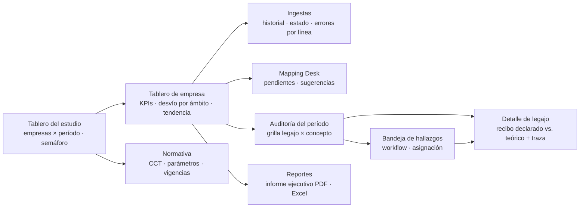

**Grilla central de auditoría (ejemplo):**

| Legajo 📌 | CUIL 📌 | Empleado 📌 | Concepto | Liquidado | Teórico | Diferencia | Desvío | Estado |
|---|---|---|---|---:|---:|---:|---:|---|
| 0142 | 20-****5678-3 | Pérez, Ana | Básico | `1.250.000,00` | `1.318.450,00` | `(68.450,00)` | `-5,19 %` | 🔴 Crítico |
| 0142 | 20-****5678-3 | Pérez, Ana | Antigüedad | `62.500,00` | `65.922,50` | `(3.422,50)` | `-5,19 %` | 🟡 Revisar |
| 0207 | 27-****4321-9 | Gómez, Luis | Ret. Ganancias | `(184.300,12)` | `(184.300,40)` | `0,28` | `0,00 %` | 🟢 OK |

### 9.3 Exportación a Excel ("XLS Siempre")

Cada vista analítica tiene el botón **Exportar a Excel** en la misma posición. Se genera **`.xlsx`** (Office Open XML: sin el límite de 65.536 filas del `.xls` binario):

| Hoja | Contenido |
|---|---|
| `Resumen` | KPIs y totales por ámbito/severidad con **fórmulas nativas** que referencian la hoja de detalle: `=SUMIFS(Detalle!G:G, Detalle!J:J, "Crítico")`, `=COUNTIFS(...)`. |
| `Detalle` | Una fila por desvío. Columnas calculadas como fórmula, no como valor: `Diferencia = E2-F2`, `Desvío = IFERROR(G2/F2, 0)`, `Estado = IF(ABS(G2)<=Parametros!$B$3, "OK", IF(ABS(G2)>=Parametros!$B$4, "Crítico", "Revisar"))`. Formato contable `#,##0.00;[Red](#,##0.00)`, formato condicional con colores del semáforo, autofiltro, paneles congelados (columnas A–C y fila 1). |
| `Parametros` | Tolerancias usadas (referenciadas por las fórmulas: el usuario puede "jugar" con los umbrales en Excel), empresa, período, versión del motor, `parametros_hash`, usuario, fecha y hora, ID de exportación. |
| `Traza` (opcional) | Detalle paso a paso del cálculo teórico para los legajos seleccionados. |

**Aspectos técnicos:**

- Exportaciones < 50.000 filas se generan en línea (*streaming* directo a la respuesta HTTP). Más grandes: job en el Worker Export con **ExcelJS `stream.xlsx.WorkbookWriter`** (memoria constante), se guarda en S3 cifrado y se entrega un enlace prefirmado de un solo uso que vence en 15 minutos.
- **Prevención de *formula injection*:** todo texto proveniente de datos del cliente (descripciones de conceptos, nombres) que empiece con `=`, `+`, `-`, `@`, tab o retorno de carro se escribe como texto literal, nunca como fórmula.
- **Gobierno de datos:** cada exportación es un **evento de seguridad auditado** (quién, qué filtro, cuántas filas, qué datos personales incluyó). Por política del tenant puede: excluir CUIL/nombre (exportación seudonimizada), exigir rol mínimo o agregar marca de agua con el usuario.

---

## 10. Seguridad, multi-tenancy y Ley 25.326

### 10.1 Roles y encuadre legal

- El **estudio contable o la empresa** contratante es el **responsable de la base de datos** (Ley 25.326, art. 2). La plataforma actúa como **prestador de servicios de tratamiento por cuenta de terceros** (art. 25): solo trata los datos para la finalidad contratada, no los cede, y al finalizar el contrato los **devuelve y destruye** (exportación completa + borrado criptográfico, §10.6).
- El contrato SaaS incluye un **Acuerdo de Tratamiento de Datos** con: finalidad, medidas de seguridad, subencargados (proveedor cloud, IdP, correo), ubicación de los datos, notificación de incidentes y asistencia para responder derechos de los titulares.
- **Datos sensibles.** La **afiliación sindical** (deducible de la cuota sindical) y los **datos de salud** (licencias médicas, ART) son datos sensibles (arts. 2 y 7). Se aíslan en columnas cifradas separadas (`datos_sensibles`), se excluyen por defecto de listados y exportaciones, y su acceso requiere un permiso explícito (`ver_datos_sensibles`) que se registra en el audit log.
- **Principios de calidad y minimización** (art. 4): solo se ingieren los campos necesarios para auditar; los parsers descartan campos del LSD/F931 que no usa ningún módulo (p.ej. domicilio) antes de persistir.
- **Inscripción** de las bases ante la autoridad de control (AAIP) por parte del responsable; la plataforma provee la descripción técnica de medidas de seguridad para el trámite y sigue las **medidas de seguridad recomendadas por la AAIP** (Res. 47/2018).

### 10.2 Defensa en profundidad

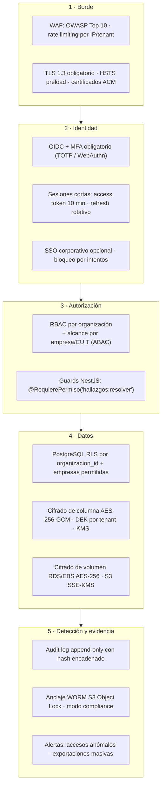

### 10.3 Aislamiento multi-tenant estricto

**Modelo:** base compartida con **Row-Level Security** (*pool model*), reforzado con claves de cifrado por tenant. Para clientes que lo exijan contractualmente (grandes empresas, bancos), el mismo código soporta un **silo dedicado** (base y bucket propios) seleccionado por configuración del tenant.

**Contexto de sesión por transacción.** Cada request (y cada job) abre una transacción y fija el contexto con `SET LOCAL` (se descarta al terminar, seguro con *connection pooling* en modo transacción):

```sql
-- Ejecutado por el interceptor de NestJS / el worker antes de cualquier consulta
SELECT set_config('app.organizacion_id', $1, true);   -- true = LOCAL a la transacción
SELECT set_config('app.empresas',        $2, true);   -- '{uuid1,uuid2}' o '*' si todas_empresas
SELECT set_config('app.usuario_id',      $3, true);
```

**Políticas RLS** (se aplican a todas las tablas de negocio; la aplicación se conecta con un rol **sin** `BYPASSRLS` ni ownership de las tablas):

```sql
CREATE ROLE app_runtime NOLOGIN;            -- rol de la aplicación (no dueño de tablas)

ALTER TABLE liquidaciones_mensuales ENABLE ROW LEVEL SECURITY;
ALTER TABLE liquidaciones_mensuales FORCE ROW LEVEL SECURITY;

CREATE OR REPLACE FUNCTION app_empresa_permitida(p_empresa UUID) RETURNS BOOLEAN
LANGUAGE sql STABLE AS $$
  SELECT current_setting('app.empresas', true) = '*'
      OR p_empresa = ANY (current_setting('app.empresas', true)::uuid[])
$$;

CREATE POLICY aislamiento_tenant ON liquidaciones_mensuales
  USING (
    organizacion_id = current_setting('app.organizacion_id', true)::uuid
    AND app_empresa_permitida(empresa_id)
  )
  WITH CHECK (
    organizacion_id = current_setting('app.organizacion_id', true)::uuid
    AND app_empresa_permitida(empresa_id)
  );
-- Ídem para empleados, liquidaciones_conceptos, calculos_teoricos_concepto, hallazgos_auditoria, etc.
-- Sin contexto fijado, current_setting(..., true) devuelve NULL y la política no deja ver ninguna fila.
```

**Controles complementarios:**

- **Test de aislamiento en CI:** suite que crea dos tenants, ejecuta cada endpoint autenticado como el tenant A y verifica que ningún ID del tenant B sea accesible (lectura, escritura, exportación, SSE).
- **Storage:** claves de objeto `s3://{bucket}/{organizacion_id}/{empresa_id}/...`; las URLs prefirmadas solo se emiten tras validar permisos; política de bucket que exige cifrado SSE-KMS con la clave del tenant.
- **Colas:** cada job lleva `organizacion_id` firmado (HMAC) en su payload; el worker fija el contexto RLS con ese valor y rechaza payloads alterados. *Rate limiting* por tenant para evitar que uno degrade a los demás (*noisy neighbor*).
- **Caché:** claves de Redis prefijadas por tenant; nunca se cachean respuestas con datos personales sin prefijo.

### 10.4 RBAC

| Permiso \ Rol | owner | supervisor | auditor | analista | cliente_lectura | auditor_externo |
|---|:-:|:-:|:-:|:-:|:-:|:-:|
| Gestionar usuarios y roles | ✅ | — | — | — | — | — |
| Alta/baja de empresas | ✅ | ✅ | — | — | — | — |
| Subir archivos / confirmar ingesta | ✅ | ✅ | ✅ | ✅ | — | — |
| Aprobar mapeos (Mapping Desk) | ✅ | ✅ | ✅ | sugerir | — | — |
| Cambiar parametrización fiscal | ✅ | ✅ | doble control | — | — | — |
| Ejecutar auditorías | ✅ | ✅ | ✅ | ✅ | — | — |
| Resolver/justificar hallazgos | ✅ | ✅ | ✅ | — | comentar | — |
| Ver hallazgos y tableros | ✅ | ✅ | ✅ | ✅ | su empresa | alcance otorgado |
| Ver datos sensibles | ✅ | ✅ | con permiso | — | — | — |
| Exportar Excel con datos personales | ✅ | ✅ | ✅ | seudonimizado | su empresa | seudonimizado |
| Ver audit log de seguridad | ✅ | — | — | — | — | — |

- Permisos **finos** (`recurso:acción`) agrupados en roles; los roles se asignan por organización y se **acotan por empresa** (`permisos_empresa`).
- `auditor_externo` exige `expira_en` y se revoca automáticamente.
- **Mínimo privilegio para el personal de la plataforma:** el soporte no tiene acceso a datos de tenants; el acceso de emergencia (*break-glass*) requiere aprobación del tenant, es temporal y queda auditado.

### 10.5 Cifrado

| Ámbito | Mecanismo |
|---|---|
| En tránsito (externo) | **TLS 1.3** exclusivamente (TLS 1.2 deshabilitado en el borde), suites AEAD (AES-256-GCM / ChaCha20-Poly1305), HSTS con `preload`. |
| En tránsito (interno) | TLS en API ↔ RDS (`sslmode=verify-full`), API ↔ Redis, workers ↔ S3. |
| En reposo — volumen | RDS/EBS cifrados con **AES-256** (KMS), snapshots y réplicas incluidos. |
| En reposo — columnas PII | **Envelope encryption**: cada tenant tiene una KEK en KMS; los datos se cifran con **AES-256-GCM** usando una DEK por tenant (cacheada en memoria con TTL corto, nunca persistida en claro). CUIL, nombre, CBU y datos sensibles van cifrados; para buscar por CUIL se usa un **blind index** HMAC-SHA256 con clave separada. |
| En reposo — objetos | S3 **SSE-KMS** con la clave del tenant, *bucket keys* habilitadas, bloqueo de acceso público, versionado. |
| Backups | Cifrados con KMS; restauración probada trimestralmente. |
| Rotación | KEKs con rotación anual automática; DEKs re-envueltas sin re-cifrar los datos. |

### 10.6 Audit Log de seguridad inmutable

**Qué se registra:** inicio/cierre de sesión y fallos de MFA, cambios de roles/permisos, accesos a datos sensibles, consultas a legajos individuales, exportaciones, cambios de mapeos y parametrización fiscal, confirmación/descarte de ingestas, cambios de estado de hallazgos, acciones de *break-glass*, cambios de normativa.

```sql
CREATE TABLE audit_log (
  id               BIGINT GENERATED ALWAYS AS IDENTITY PRIMARY KEY,
  ocurrido_en      TIMESTAMPTZ NOT NULL DEFAULT clock_timestamp(),
  organizacion_id  UUID,
  usuario_id       UUID,
  ip               INET,
  user_agent       TEXT,
  accion           TEXT NOT NULL,           -- 'export.excel', 'legajo.ver_sensible', ...
  recurso_tipo     TEXT,
  recurso_id       TEXT,
  detalle          JSONB NOT NULL,          -- sin datos personales en claro
  hash_anterior    BYTEA NOT NULL,
  hash             BYTEA NOT NULL           -- SHA-256(hash_anterior || fila canonicalizada)
);

-- Solo inserciones: el rol de la aplicación no puede modificar ni borrar
REVOKE UPDATE, DELETE, TRUNCATE ON audit_log FROM PUBLIC, app_runtime;
GRANT INSERT, SELECT ON audit_log TO app_runtime;

CREATE FUNCTION audit_log_inmutable() RETURNS trigger LANGUAGE plpgsql AS $$
BEGIN
  RAISE EXCEPTION 'audit_log es append-only';
END $$;
CREATE TRIGGER audit_log_no_update BEFORE UPDATE OR DELETE ON audit_log
  FOR EACH ROW EXECUTE FUNCTION audit_log_inmutable();
```

- **Hash encadenado:** cada fila incluye el hash de la anterior; alterar o borrar una fila rompe la cadena desde ese punto (verificación diaria automática).
- **Anclaje WORM:** cada hora se exporta el bloque nuevo + el último hash a **S3 con Object Lock en modo *compliance*** (ni siquiera la cuenta raíz puede borrarlo antes del vencimiento). Retención: 5 años por defecto, configurable.
- **Alertas** (SIEM): exportaciones fuera de patrón, accesos masivos a legajos, inicios de sesión desde países inusuales, cambios de rol de owner.

### 10.7 Derechos de los titulares, retención y eliminación

- **Acceso, rectificación y supresión** (arts. 14 a 16): la plataforma ofrece al responsable herramientas para responder dentro de los plazos legales — búsqueda por CUIL (vía blind index), exportación de todos los datos de un titular, rectificación con trazabilidad. Las liquidaciones declaradas no se "editan": se registra la rectificación como nueva versión con su justificación.
- **Retención:** configurable por tenant; por defecto 10 años, alineado con plazos de prescripción de obligaciones de la seguridad social. Purga por particiones vencidas.
- **Fin de contrato:** exportación completa (Excel + JSON + archivos originales) y luego **borrado criptográfico**: se programa la eliminación de la KEK del tenant en KMS, lo que vuelve ilegibles las columnas cifradas y los objetos aun dentro de backups; las filas se eliminan físicamente y los backups expiran por su ciclo natural.
- **Notificación de incidentes:** procedimiento documentado con plazos de comunicación al responsable y soporte para que este notifique a titulares y autoridad.

### 10.8 Seguridad del ciclo de desarrollo

- Revisión de código obligatoria, SAST (CodeQL/Semgrep), análisis de dependencias (Dependabot, `npm audit`), escaneo de imágenes (Trivy), detección de secretos (gitleaks).
- Secretos en **AWS Secrets Manager**; nada en variables de entorno de repositorio (el `.env.example` actual es solo para desarrollo local).
- Datos de prueba **sintéticos** (CUILs con dígito verificador válido pero generados); prohibido usar copias de producción en entornos no productivos.
- Pentest externo anual y antes de cada lanzamiento mayor; programa de divulgación responsable.

---

## 11. Infraestructura, despliegue y operación

### 11.1 Topología de despliegue (AWS)

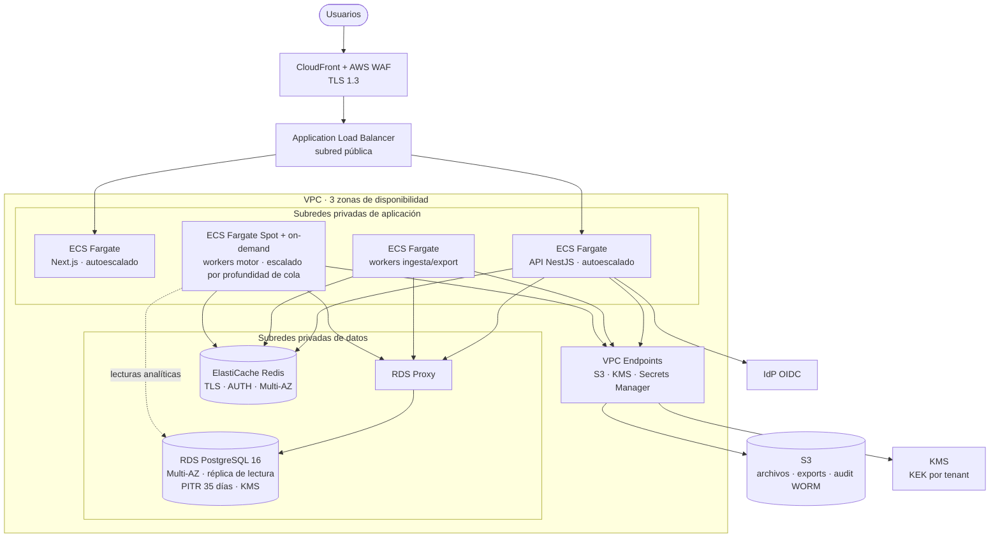

### 11.2 Residencia de datos y transferencia internacional

Ley 25.326 art. 12 restringe la transferencia de datos personales a países sin nivel de protección adecuado. Opciones, en orden de preferencia según el perfil de cliente:

1. **Infraestructura en Argentina** (proveedores con presencia local o *Local Zones* de Buenos Aires para los componentes de datos), cuando el cliente lo exija.
2. **Región cloud fuera de Argentina** (p.ej. `sa-east-1`, São Paulo, por latencia) amparada en **cláusulas contractuales modelo** aprobadas por la autoridad de control para transferencias internacionales, con el consentimiento/información correspondiente incluido en el acuerdo con el responsable.

La decisión es **por tenant** (el silo dedicado permite región específica) y debe validarse con asesoría legal. Los backups y el DR quedan en la misma jurisdicción que los datos primarios.

### 11.3 Entornos y entrega continua

- **Entornos:** `dev` (docker compose, como hoy) → `staging` (datos sintéticos, infraestructura idéntica) → `prod`.
- **Pipeline (GitHub Actions):** lint + typecheck + tests unitarios del motor (golden files) → tests de integración con PostgreSQL efímero (incluye suite de aislamiento RLS) → build de imágenes + escaneo → migraciones con `prisma migrate deploy` (revisadas: solo cambios compatibles hacia atrás, patrón *expand/contract*) → despliegue *blue/green* en ECS.
- **Infraestructura como código:** Terraform, con módulos por entorno y política de cifrado obligatoria verificada (tfsec/Checkov).

### 11.4 Continuidad del negocio

| Métrica | Objetivo |
|---|---|
| Disponibilidad | 99,9 % mensual (picos de uso: días 1–15 de cada mes, vencimientos de F931) |
| RPO | ≤ 5 minutos (PITR de RDS) |
| RTO | ≤ 4 horas (restauración en otra zona; runbook probado semestralmente) |

---

## 12. Atributos de calidad

### 12.1 Rendimiento y escalabilidad

| Escenario | Objetivo |
|---|---|
| Ingesta LSD de 5.000 legajos (~300.000 líneas) | parseo + validación < 60 s |
| Auditoría completa de 10.000 legajos / período | < 5 min (paralelizada en *chunks* de 250 legajos) |
| Grilla de auditoría: ordenar/filtrar 500.000 filas | p95 < 300 ms (servidor, keyset + índices) |
| Exportación Excel de 200.000 filas | < 90 s (job asíncrono, memoria constante) |

- **Escalado de workers por profundidad de cola** (métrica de BullMQ → autoescalado de ECS). Las colas se separan por tipo (`ingesta`, `automatch`, `motor`, `export`) y por prioridad (re-auditorías masivas por cambio normativo en prioridad baja).
- **Fan-out del motor:** un job "padre" por empresa/período genera N jobs hijos por *chunk* de legajos (BullMQ *flows*); el padre consolida resultados y dispara el refresco de vistas materializadas.
- **Lecturas analíticas** contra la réplica de lectura. Si el volumen crece más allá de lo razonable en PostgreSQL, se evalúa un almacén columnar (ClickHouse) alimentado por CDC solo para tableros, sin cambiar la fuente de verdad.

### 12.2 Observabilidad

- **Trazas** OpenTelemetry de punta a punta (request → job → consultas SQL) con atributos `tenant_id`, `empresa_id`, `corrida_id` (nunca CUIL ni nombres).
- **Métricas de negocio:** ingestas por estado, % de conceptos auto-mapeados, tiempo medio de resolución en el Mapping Desk, hallazgos por severidad y ámbito, duración de corridas.
- **Logs estructurados** (JSON) con redacción automática de PII.
- **SLOs y alertas** sobre latencia de API, antigüedad del job más viejo en cola y errores de parseo por layout (detecta temprano un cambio de formato de ARCA).

---

## 13. Migración desde el MVP y roadmap

### 13.1 Correspondencia con el código actual

| MVP actual | Plataforma |
|---|---|
| `Cliente` | `empresas` (CUIT) dentro de una `organizaciones` (tenant) |
| `Usuario.rol` (admin/auditor/cliente_lectura) | `membresias` + `permisos_empresa` (RBAC acotado por empresa) |
| `ConceptoCliente` + `conceptos-cliente.parser.ts` | `conceptos_empresa` + `mapeo_conceptos_empresa` (Mapping Desk) |
| `RemuneracionMensual` (importada de nómina) | Se **deriva** de `liquidaciones_conceptos` (conceptos que integran la base 245) |
| `nomina-importada.parser.ts`, `recibo-liquidacion.parser.ts` | Parsers del Worker Ingesta (plantillas ERP) |
| `packages/motor-calculo` | Se mantiene como `@audit/motor-calculo` (módulo Egresos) sobre `motor-core` |
| `Auditoria` + `Hallazgo` | `corridas_auditoria` + `hallazgos_auditoria` (se agrega un `ambito = 'EGRESOS'`) |
| `Documento` + MinIO | `archivos_ingesta` + S3 con SSE-KMS |

### 13.2 Fases

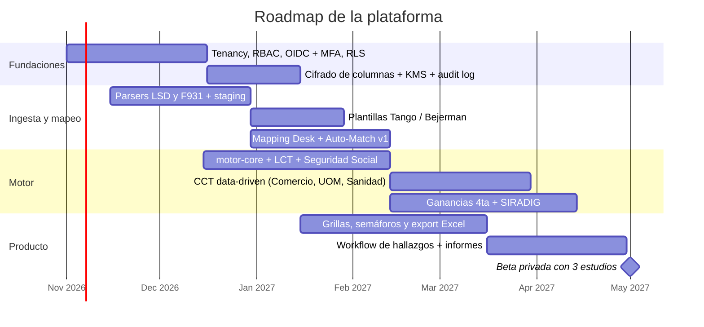

**Criterio de salida de la beta:** ≥ 85 % de conceptos auto-mapeados con precisión ≥ 98 % en los mapeos auto-aprobados; diferencias del motor contra liquidaciones validadas manualmente ≤ $ 1 en el 99 % de los conceptos; suite de aislamiento RLS sin fallas; pentest externo sin hallazgos críticos abiertos.

---

## 14. Registro de decisiones (ADRs) y riesgos

### 14.1 ADRs

| ADR | Decisión | Alternativas descartadas | Motivo |
|---|---|---|---|
| 001 | Monolito modular NestJS + workers | Microservicios desde el día 1 | Equipo chico, dominio aún en descubrimiento; los módulos con eventos *outbox* permiten extraer servicios después. |
| 002 | Multi-tenant *pool* con RLS + silo opcional | Schema por tenant; base por tenant para todos | RLS da aislamiento garantizado por el motor de base con costo operativo bajo; el silo cubre a los clientes que lo exijan. |
| 003 | Lógica legal en TypeScript + valores como datos + DSL acotada para adicionales | Motor de reglas genérico (Drools/JSON-rules) | Las reglas de Ganancias y SS requieren tipado, Decimal y tests; una DSL genérica las vuelve opacas. |
| 004 | Cifrado de columnas a nivel aplicación + blind index | Solo cifrado de volumen; `pgcrypto` en la base | Un *dump* o una consulta mal filtrada no expone PII; las claves nunca llegan a la base. |
| 005 | Auto-Match heurístico explicable con calibración | Clasificador de ML opaco / LLM | Los auditores necesitan entender y defender cada mapeo; se puede incorporar *embeddings* como una señal más. |
| 006 | `.xlsx` con fórmulas nativas vía ExcelJS streaming | `.xls` binario; CSV | Sin límite de filas, fórmulas y formato contable; CSV pierde fórmulas y formatos. |
| 007 | Liquidaciones declaradas inmutables y versionadas | Actualizar en el lugar | Evidencia de auditoría y reproducibilidad. |

### 14.2 Riesgos principales

| Riesgo | Impacto | Mitigación |
|---|---|---|
| Cambios frecuentes de normativa (paritarias mensuales, actualización de tablas de Ganancias, topes SS) | Cálculos teóricos desactualizados → falsos positivos | Equipo de curaduría con SLA de carga (≤ 48 h hábiles desde la publicación), alertas de "parámetro faltante para el período", re-auditoría dirigida. |
| Cambio de layout de LSD/F931 por ARCA | Ingestas fallidas | Layouts versionados, monitoreo de tasa de errores por layout, suite de archivos de ejemplo por versión. |
| Heterogeneidad de exportaciones de ERPs | Fricción en el onboarding | Plantillas por ERP + asistente de mapeo de columnas guardado por empresa. |
| Falsos positivos que erosionan la confianza | Abandono del producto | Tolerancias configurables, traza explicable, supresión de patrones justificados, métricas de precisión por regla. |
| Fuga de datos entre tenants | Crítico (legal y reputacional) | RLS forzado, tests de aislamiento en CI, cifrado por tenant, pentest. |
| Interpretaciones normativas discutibles (habitualidad, naturaleza de sumas no remunerativas) | Hallazgos controvertidos | La regla expone su criterio y fuente; el tenant puede elegir criterio alternativo documentado; el resultado es un *hallazgo a revisar*, no una conclusión legal. |
